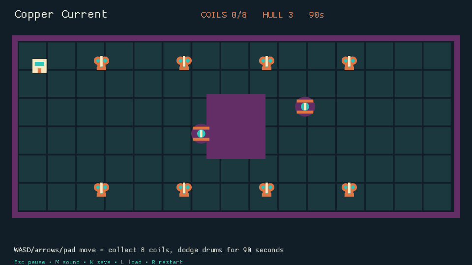
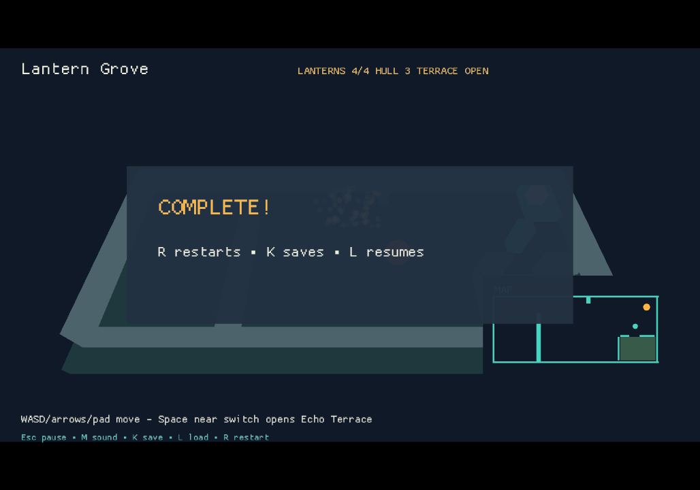

# Agent loop trace — Phase 1

Measured on 2026-10-10 PDT / 2026-10-11 UTC, from engine revision
`2354e507975594a76046058470c70934cad9e6e8`. Phase 2 has **not** started.
No optimization, CLI consolidation, starter change or official artwork edit is in the report branch.
The requested game experiments and validator exercise live in separate worktrees/commits.

The largest measured wall costs are verification/build work, including different Cargo profiles
and an engine consumer graph that selects networking/deployment checks for a name validator.
The largest measured navigation cost is mandatory guide/API material outside the initial game
packets. Evidence invalidation adds unchanged retries and makes the mandatory feedback step
revoke a previously accepted game shipping result.

## Method and limits

These are three sequential tasks by one agent in clean **source worktrees**, following the root
AGENTS and selected packet paths, with deviations recorded below. They are not independent
fresh-model cohorts: the same conversation and shared dependency/cache state carried between tasks.
The model's billed input/output tokens, reasoning tokens and API turn counts are unavailable.
`o200k_base` counts below measure complete instrumented packet/read artifacts, including bytes
that a tool may truncate when displaying them. They are reproducible text-volume proxies, not
claims about actual billed agent spend. Prompt, code-draft, image and report-writing tokens are excluded.

One verification **cycle** means edit/run/review or an unchanged retry, rather than an API turn.
All agent-issued be2 commands are listed below. The accompanying
[measurements and command inventory](AGENT_LOOP_TRACE_MEASUREMENTS.json) also lists every
successfully started be2.py/be2-tools child process captured with `strace -f -e execve`, including
expected-negative tests. Failed PATH probes are excluded. Sensitive test arguments are redacted.
Internal calls that do not start a CLI process are not CLI invocations. Synthetic calls inside tests
are separate from agent decisions; their packet stdout is not counted as agent context.
Packet bytes include the output newline. Wall values in loop tables come from check reports;
wrapper wall includes tracing/probes/serialization and is separately retained in the inventory.
The first failed scaffold's wrapper timing was contaminated by a detached sccache daemon and is
excluded from comparative totals; the underlying Cargo ENOSPC failure remains recorded.

Host: Linux 6.12.111, Intel N97, four cores, Rust 1.98.1, mold and sccache.
The first target resolved to a full USB cache. Subsequent runs used the existing
`CARGO_TARGET_DIR=/home/kevin/.cache/blue-hardening-target` with warm dependencies, mixed engine
artifacts, initially cold game dev/client variants, and a new release directory. Different worktree
paths themselves cause crate rebuilds. Root and `/tmp` capacity also failed during B/C.
Hash-verified copies of trace-owned libraries/incremental caches/executables preserved paths and
outputs while freeing capacity. One overly broad incremental-directory relocation was rolled back
with verified byte preservation before moving source-identified subdirectories. These interventions
and the initial tracer fault are instrumentation/host costs, not demonstrated engine regressions.
Cold/warm rows are different conditions, never a before/after optimization claim.

Linux native runs used Xvfb, Mesa software rendering and null ALSA. Windows evidence comes from
the existing Forge game checks workflow, using its pinned Mesa driver, on the temporary
`perf/agent-loop-windows-20261010` branch (games only, unchanged engine).
This is a platform continuation of authored artifacts, not a second fresh-agent authoring cohort.
CI step timing is reported separately from local be2 loop timing. CI logs/manifests/captures verify
packaged launches; physical keyboard/controller/audio and installed desktop shortcuts are unverified.

## Ranked sinks and proposed consolidation

Ranking combines measured wall cost with repeatable unnecessary navigation/recovery.
Compilation and capacity effects are large but confounded; the table does not assign all build time
to a removable defect. No speedup or after measurement exists yet.

| Rank | Sink | Before observation | Consolidation to test in Phase 2 | After |
|---|---|---|---|---|
| 1 | Verification profiles and consumer fanout | A first inner 188.300 s, native integration 188.637 s, Linux shipping 90.285 s; B baseline 66.195 s. C inner green 241.009 s/1,216 tests and warm integration 360.287 s/2,125 tests. Hub-deployment Python alone takes 73.183/67.809 s. Schema write/check adds 52.991/24.625 s while producing no changes. | Audit existing feature ownership/consumer edges and shared check implementations; preserve both feature modes and final Linux/Windows CI. Measure a normal-capacity warm rerun before attributing a reduction. Reuse shared authoring freshness/discovery in older game scripts. | Not run |
| 2 | Evidence identity and recovery cause repeated work | A first inner passed tests but was rejected after first-use Cargo.lock; unchanged retry 0.799 s plus report inspection. Shipping invalidated prior inner/integration with unchanged sources. Required learning revoked accepted shipping in **both games**. B tool discovery failed before execution; nested disk-full diagnosis required two log hops. | Consolidate task input binding and the existing check-report failure path. Scope proof to relevant source/declared package inputs; preserve required invalidation for real engine edits. Surface nested root diagnostics and current shared tool paths. | Not run |
| 3 | Packet reach, dense guides and disconnected feedback | A 8,454 and B 13,389 extra-navigation artifact tokens beyond packet-selected material/initial AGENTS. GAME_QUICKSTART alone costs 4,381 tokens each. B needed four extra engine owners for save migration/fixture APIs. Broad C context cost 1,353 tokens vs exact feature 528; final C next expands to 14,925 bytes/3,869 tokens with retained failure commands. New feedback retrieved through context but A start traps remained empty. | Consolidate required guide sections, selected metadata and save migration examples into existing leveled context; make start use the existing learning retrieval path. Remove stale generated browser guidance. Keep guides/packets derived from one contract rather than adding another entrypoint. | Not run |

The native shipping **successful** local gates are 90.285 s (A) and 40.046 s (B), but B's
two failed shipping attempts add 0.476 + 70.236 s. The 70.236 s disk failure is host capacity,
not an estimate of avoidable engine time. The successful gates also aggregate nested builds
as zero Cargo artifacts/test cases: their instrumentation does not expose the full inner cost.
Retained nested logs provide evidence; aggregate zero is not evidence that no build occurred.

## A — Copper Current, new two-d native game

The game collects eight Coil Blooms while dodging moving Storm Drums over 5,400 fixed 60 Hz
ticks (90 seconds), with three hull points and a copper/teal/plum/cream palette. Both prop drawings
are local primitive compositions. Tests exercise a public-input winning route, deterministic replay,
save/resume, exact timer bounds, missing pickups, collision/cooldown and terminal freeze.
Five tests passed on the first code verification attempt; two unchanged inner attempts were needed
for the packet to accept initial proof. The work is reproducible at local commit `bef6a97` and
[the temporary CI game source](https://github.com/kevstermcgee/BlueEngine/tree/perf/agent-loop-windows-20261010/games/copper-current).

The first start named two-d only in prose; the packet selected portable. The agent had omitted
the explicit `--template two-d` flag and discovered it through the root-required guide plus
AI_SPRINGBOARD. A corrected start selected two-d. This is an agent flag mistake plus a routing
ambiguity, not proof that the two-d starter failed. A first map build then hit the full USB cache;
no game output was created. Retrying with the usable shared cache scaffolded the game.

The packet selected AGENTS/project/source, while required identity tagline/controls and README
still described starter lanterns. Those two small extra reads enabled correct authored metadata.
An initial patch draft failed because it attempted delete/add of the same file; one corrected
authoring batch plus formatting implemented the game. The agent inferred `menu_status()`'s
return type from existing guidance; compilation confirmed it.

`next` rejected the first green inner run: game sources were unchanged, but the game's new
Cargo.lock also changed the whole in-tree engine source inventory. The unchanged retry passed.
After that, next suggested integration although the root standalone-game paragraph says
inner → shipping; the game AGENTS also explicitly describes native integration. This trace followed
next and ran integration. A Windows-only shipping request on Linux correctly refused undeclared
Linux delivery and named the deliberate target edit. Windows was retained and Linux was added
as a development target; new task binding required warm inner/integration repeats before the
Linux gate. This does not substitute Linux for the requested Windows package.

After Linux shipping, next accepted shipping while invalidating older inner/integration despite
unchanged source identity. Required learning recorded three traps. Direct context retrieved them,
but a read-only start with the **same retrieval query** returned empty `context.traps`. Appending
the required ledger then invalidated all previously accepted local task proofs. Archived passing
reports remain passing observations; the packet's current-input state is reported separately.

Inspected Linux `shot_00030.png`: both original prop forms, palette and readable playing HUD.
The full 90-second authority route is tested; a short native smoke image is not a manual 90-second playtest.

## B — Lantern Grove, switch plus Echo Terrace

A nearby Space/action intent opens a one-shot terrace gate; new collision walls, raised floor,
switch drawing, minimap and HUD agree with the added section. Existing four-lantern win behavior
remains intact. State gained `terrace_open`, Snapshot version 2 and a version-one migration.
A genuine old framed save was produced using the engine API before editing, retained as a fixture,
and verifies a legacy player inside the new section is not trapped. Public-input tests cover
remote-action rejection, closed gate blocking, one-shot cue/action, entering the terrace, victory,
determinism and save/resume. Six tests passed on the first post-edit inner attempt.
Local source commit `558e08e`; [CI source](https://github.com/kevstermcgee/BlueEngine/tree/perf/agent-loop-windows-20261010/games/lantern-grove).

The packet first requested a baseline inner run, which cost 66.195 s before implementation.
This portable custom game has no stock GameDocument/map pair: the agent considered
`add-interactable`, then used its simulation and Scene/World composition rather than inventing
stock map records. Root AGENTS references save documentation, but the selected 2D contract did
not explain migration state payloads or the public fixture-writing namespace. Navigation required
Snapshot dispatch, savestate, crate exports and viewer exports. The agent guessed a nonexistent
`savestate/slots.rs`, searched two unhelpful source windows, and tried an incorrect root SaveSlots
namespace. The compiler error did not name the correct namespace; inspecting actual exports fixed it.
These mistakes are recorded, not attributed entirely to documentation.

Level-three context then selected the client owner; its public input code confirmed Space maps
to action. The old game AGENTS still requests WASM/Node/Chromium while root policy and packet
declare browser gameplay retired. Current native policy was followed; no browser prerequisites installed.
Post-edit next suggested integration, but this trace followed the user's inner → shipping request
and the packet's completion command.

Shipping attempt one failed because the old checker ignored the shared itest tool already found
by the packet. Its diagnostic named `BE2_TOOLS`, so map describe freshened the tool and the
documented explicit override was used. Attempt two spent 70.236 s and failed native linking.
The outer recovery only said to inspect a log whose content pointed to another log. A bounded
search of the nested log found mold's disk-full error, with a noisy long linker line. After capacity
recovery, attempt three passed in 40.046 s. Required published-source validation also passed.
Three learning entries retrieved correctly through context; appending them revoked current
shipping proof. Inspected Linux and Windows native captures: title, terrace-open HUD, minimap,
controls and completed route render; real keyboard/controller use remains unverified.

## C — game-validate, whitespace-only name rule

The isolated exercise rejects empty, ASCII-whitespace and Unicode-whitespace names and names
the fix in the diagnostic. Padded nonblank names remain intact. The test invokes the public
game-validate CLI against genuine generated content; a public guide describes the contract.
Only `src/viewer/game.rs`, `tests/game_documents.rs` and `docs/GAME_QUICKSTART.md` changed.
It is preserved at local commit `9a68887` on `perf/agent-loop-task-c`, an experimental validation
change, not a Phase 2 optimization and not in the report branch.

The agent first invented `start --feature`; usage rejected it. A corrected prose lookup had low
confidence and next requested contract context. Exact `context game_documents --level 2/3`
removed two irrelevant matches. Selected owners showed the original proposed interaction-label
rule belonged to map data, so the task was narrowed to one name rule and restarted with explicit
`--path src/viewer/game.rs`. The implementation used only selected owners. A later hub failure
required one extra bounded source read (327 artifact tokens) at the diagnostic's named span.

The root schema-maintenance instruction triggered schemas write/check. All four committed schemas
were unchanged: this semantic whitespace rule does not change their structural grammar. These
commands nevertheless compiled schema-generation and schema-validation variants (52.991/24.625 s).
Changed inner planning mapped the quickstart to custom_simulation/game_shipping as well as
game_documents, selecting 18 affected features, 37 integration suites, whole-library units and
tooling checks. The first inner link failed on full `/tmp`, before any tests. Unchanged retry passed
1,216 tests in 241.009 s and next accepted its current-input proof. Integration runs the same
consumer suites in both native and headless modes plus boundary checks and repeats tooling.
Its first native link failed on capacity too. The second integration attempt reached 623 library
tests, with 622 passing and the hub retry-timing test reporting only two observed retries. That
named test passed alone in 0.45 s (0.735 s CLI wall); full unchanged integration was retried.
The isolated pass is consistent with scheduling sensitivity, not proof of its cause. No hub code
was changed or tests skipped. The third integration attempt passed 2,125 tests in **360.287 s**
(601 fresh artifacts, zero built); native/headless stages took 124.995/127.529 s, hub-deployment
Python 67.809 s. Final next accepted both inner and integration current-input proofs, leaving
shipping/full-platform obligations unverified. All integration attempts remain in the ledger.
Full shipping/default check and Linux/Windows engine CI remain requirements before merging this
experimental engine rule; game-only CI on the other branch cannot certify it.

## A measurement ledger

### Packets

| Call | Kind / level | Bytes | Tokens (proxy) | CLI wall s | Result |
| --- | --- | --- | --- | --- | --- |
| a002-run | start | 4601 | 1109 | 0.914 | packet |
| a005-run | start | 4582 | 1111 | 0.497 | packet |
| a010-run | next | 6043 | 1505 | 0.570 | packet |
| a011-run | context/2 | 1493 | 352 | 0.107 | packet |
| a018-run | next | 6401 | 1608 | 1.119 | packet |
| a021-run | next | 6346 | 1610 | 0.578 | packet |
| a025-run | next | 6725 | 1723 | 0.581 | packet |
| a027-run | start | 6225 | 1548 | 0.698 | packet |
| a031-run | next | 7138 | 1816 | 0.749 | packet |
| a033-run | context/2 | 1493 | 352 | 0.128 | packet |
| a039-run | context/2 | 5547 | 1228 | 0.111 | packet |
| a040-run | next | 7307 | 1873 | 0.686 | packet |
| a041-run | start | 6013 | 1494 | 0.574 | packet |

### Verification attempts

| Report | Tier | Pass | Wall s | Commands | Tests | Cargo fresh/built |
| --- | --- | --- | --- | --- | --- | --- |
| `check-20261011T030121830305Z-ntts9anc` | inner | True | 188.300 | 2 | 5 | 0/126 |
| `check-20261011T030539260151Z-i0svzz_k` | inner | True | 0.799 | 1 | 5 | 126/0 |
| `check-20261011T030609767700Z-i4e_051s` | integration | True | 188.637 | 3 | 10 | 219/83 |
| `check-20261011T031046564958Z-kasgx2r5` | shipping | False | 1.426 | 2 | 0 | 0/0 |
| `check-20261011T031215628723Z-5yuykn1g` | inner | True | 0.710 | 1 | 5 | 126/0 |
| `check-20261011T031224541240Z-c_ipx69z` | integration | True | 1.178 | 3 | 10 | 302/0 |
| `check-20261011T031229354051Z-ykanmyt4` | shipping | True | 90.285 | 2 | 0 | 0/0 |

Report IDs are relative to the task worktree `.be2-work/`. Shipping aggregate zero test/artifact counts hide nested scripts; see the scope caveat above.

### Agent be2 command sequence

All flags/objectives are retained; `{worktree-a}`, `{shared-target}` and `{external-evidence}` normalize the paths described in Method. Run from the task worktree. Child CLI invocations, including automated regressions, are enumerated in the measurements JSON.

| Call | Command | Exit | Wrapper s |
| --- | --- | --- | --- |
| a002-run | `python3 tools/be2.py start 'Build Copper Current, a 90-second native collect-and-dodge game with a unique copper/teal/plum palette and two original authored props; do not use assets/props or any kit; use the two-d starter' --kind new-game --target windows --project games/copper-current --compact` | 0 | 0.914 |
| a005-run | `python3 tools/be2.py start 'Build Copper Current, a 90-second native collect-and-dodge game with a unique copper/teal/plum palette and two original authored props; do not use assets/props or any kit' --kind new-game --target windows --template two-d --project games/copper-current --compact` | 0 | 0.497 |
| a007-run | `env CARGO_TARGET_DIR=/home/kevin/BlueEngine/target python3 tools/be2.py map new-game copper-current '{worktree-a}/games/copper-current' '{worktree-a}' two-d` | -9 | excluded: tracer fault |
| a008-run | `env 'CARGO_TARGET_DIR={shared-target}' python3 tools/be2.py map new-game copper-current '{worktree-a}/games/copper-current' '{worktree-a}' two-d` | 0 | 21.728 |
| a010-run | `env 'CARGO_TARGET_DIR={shared-target}' python3 tools/be2.py next 806502f47479 --compact` | 0 | 0.570 |
| a011-run | `env 'CARGO_TARGET_DIR={shared-target}' python3 tools/be2.py context two_dimensional --level 2 --compact` | 0 | 0.107 |
| a015-run | `env 'CARGO_TARGET_DIR={shared-target}' python3 tools/be2.py check --game games/copper-current --loop inner --task 806502f47479` | 0 | 188.796 |
| a017-run | `env 'CARGO_TARGET_DIR={shared-target}' python3 tools/be2.py check --game games/copper-current --loop shipping --task 806502f47479 --plan` | 0 | 0.225 |
| a018-run | `env 'CARGO_TARGET_DIR={shared-target}' python3 tools/be2.py next 806502f47479 --compact` | 0 | 1.119 |
| a020-run | `env 'CARGO_TARGET_DIR={shared-target}' python3 tools/be2.py check --game games/copper-current --loop inner --task 806502f47479` | 0 | 1.325 |
| a021-run | `env 'CARGO_TARGET_DIR={shared-target}' python3 tools/be2.py next 806502f47479 --compact` | 0 | 0.578 |
| a023-run | `env 'CARGO_TARGET_DIR={shared-target}' python3 tools/be2.py check --game games/copper-current --loop integration --task 806502f47479` | 0 | 189.151 |
| a025-run | `env 'CARGO_TARGET_DIR={shared-target}' python3 tools/be2.py next 806502f47479 --compact` | 0 | 0.581 |
| a026-run | `xvfb-run -a env 'CARGO_TARGET_DIR={shared-target}' LIBGL_ALWAYS_SOFTWARE=1 'ALSA_CONFIG_PATH={external-evidence}/asound.conf' python3 tools/be2.py check --game games/copper-current --loop shipping --task 806502f47479` | 2 | 2.150 |
| a027-run | `xvfb-run -a env 'CARGO_TARGET_DIR={shared-target}' LIBGL_ALWAYS_SOFTWARE=1 'ALSA_CONFIG_PATH={external-evidence}/asound.conf' python3 tools/be2.py start 'Build Copper Current, a 90-second native collect-and-dodge game with a unique copper/teal/plum palette and two original props; no assets/props or kit. Windows delivery plus Linux development evidence.' --kind new-game --target windows --target linux --template two-d --project games/copper-current --compact` | 0 | 0.698 |
| a028-run | `xvfb-run -a env 'CARGO_TARGET_DIR={shared-target}' LIBGL_ALWAYS_SOFTWARE=1 'ALSA_CONFIG_PATH={external-evidence}/asound.conf' python3 tools/be2.py check --game games/copper-current --loop inner --task 8a861949fb0b` | 0 | 1.343 |
| a029-run | `xvfb-run -a env 'CARGO_TARGET_DIR={shared-target}' LIBGL_ALWAYS_SOFTWARE=1 'ALSA_CONFIG_PATH={external-evidence}/asound.conf' python3 tools/be2.py check --game games/copper-current --loop integration --task 8a861949fb0b` | 0 | 1.827 |
| a030-run | `xvfb-run -a env 'CARGO_TARGET_DIR={shared-target}' LIBGL_ALWAYS_SOFTWARE=1 'ALSA_CONFIG_PATH={external-evidence}/asound.conf' python3 tools/be2.py check --game games/copper-current --loop shipping --task 8a861949fb0b` | 0 | 90.909 |
| a031-run | `xvfb-run -a env 'CARGO_TARGET_DIR={shared-target}' LIBGL_ALWAYS_SOFTWARE=1 'ALSA_CONFIG_PATH={external-evidence}/asound.conf' python3 tools/be2.py next 8a861949fb0b --compact` | 0 | 0.749 |
| a033-run | `env 'CARGO_TARGET_DIR={shared-target}' python3 tools/be2.py context two_dimensional --level 2 --compact` | 0 | 0.128 |
| a039-run | `env 'CARGO_TARGET_DIR={shared-target}' python3 tools/be2.py context 'new-game starter first-use Cargo.lock evidence identity README shipping package' --compact` | 0 | 0.111 |
| a040-run | `xvfb-run -a env 'CARGO_TARGET_DIR={shared-target}' LIBGL_ALWAYS_SOFTWARE=1 'ALSA_CONFIG_PATH={external-evidence}/asound.conf' python3 tools/be2.py next 8a861949fb0b --compact` | 0 | 0.686 |
| a041-run | `env 'CARGO_TARGET_DIR={shared-target}' python3 tools/be2.py start 'new-game starter first-use Cargo.lock evidence identity README shipping package' --kind new-game --project games/copper-current --template two-d --target windows --target linux --compact --no-save` | 0 | 0.574 |

### Read/navigation ledger

| Call | Paths or bounded search | Role | Tokens (proxy) | Why |
| --- | --- | --- | --- | --- |
| a001-read | `AGENTS.md` | initial AGENTS | 1939 | Required entry instructions |
| a003-read | `docs/PORTABLE_GAMES.md, templates/two-d/AGENTS.md` | packet/context selected | 2107 | Start packet references; inspect required starter guide before editing |
| a004-read | `docs/GAME_QUICKSTART.md, docs/AI_SPRINGBOARD.md` | extra navigation | 5704 | AGENTS.md requires quickstart; explicit starter flag absent from compact packet |
| a006-read | `docs/TWO_D.md` | packet/context selected | 1044 | Explicit two-d packet selects its API guide |
| a009-read | `games/copper-current/AGENTS.md, games/copper-current/game.project.json, games/copper-current/src/lib.rs` | packet/context selected | 2136 | Scaffolded project files named by packet and local AGENTS.md |
| a012-read | `games/copper-current/assets/identity.json, games/copper-current/README.md` | extra navigation | 131 | Update player-facing metadata to match objective; these paths are absent from packet project_files |
| a019-read | `.be2-work/check-20261011T030121830305Z-ntts9anc/report.json` | extra navigation | 2418 | Next invalidated successful inner result without naming cause; read its bound report to find mismatch |
| a022-read | `games/copper-current/Cargo.toml` | extra navigation | 201 | Inspect generated build profile before native package gate on constrained host; path omitted from packet |

Native CLI executions by subcommand (automatic tests included): `new-game` × 1.

## B measurement ledger

### Packets

| Call | Kind / level | Bytes | Tokens (proxy) | CLI wall s | Result |
| --- | --- | --- | --- | --- | --- |
| b002-run | start | 5594 | 1397 | 0.819 | packet |
| b006-run | context/2 | 1493 | 352 | 0.143 | packet |
| b022-run | context/3 | 2532 | 620 | 0.119 | packet |
| b027-run | next | 6103 | 1565 | 0.581 | packet |
| b035-run | next | 9334 | 2495 | 0.563 | packet |
| b039-run | context/2 | 5865 | 1286 | 0.131 | packet |
| b040-run | next | 9545 | 2560 | 0.692 | packet |

### Verification attempts

| Report | Tier | Pass | Wall s | Commands | Tests | Cargo fresh/built |
| --- | --- | --- | --- | --- | --- | --- |
| `check-20261011T032110623653Z-zm1sfrhe` | inner | True | 66.195 | 1 | 3 | 121/5 |
| `check-20261011T032732928419Z-bd3udp6j` | inner | True | 3.124 | 1 | 6 | 123/3 |
| `check-20261011T032944448351Z-4wlj2i9j` | shipping | False | 0.476 | 1 | 0 | 0/0 |
| `check-20261011T033708857194Z-ndokixyg` | shipping | False | 70.236 | 1 | 0 | 0/0 |
| `check-20261011T033957012959Z-z6u2du6i` | shipping | True | 40.046 | 2 | 0 | 0/0 |

Report IDs are relative to the task worktree `.be2-work/`. Shipping aggregate zero test/artifact counts hide nested scripts; see the scope caveat above.

### Agent be2 command sequence

All flags/objectives are retained; `{worktree-a}`, `{shared-target}` and `{external-evidence}` normalize the paths described in Method. Run from the task worktree. Child CLI invocations, including automated regressions, are enumerated in the measurements JSON.

| Call | Command | Exit | Wrapper s |
| --- | --- | --- | --- |
| b002-run | `env 'CARGO_TARGET_DIR={shared-target}' python3 tools/be2.py start 'Change lantern-grove: add one interactable switch and a new Echo Terrace map section that the switch unlocks; preserve existing game rules and save compatibility' --kind change-game --project games/lantern-grove --compact` | 0 | 0.819 |
| b005-run | `env 'CARGO_TARGET_DIR={shared-target}' python3 tools/be2.py check --game games/lantern-grove --loop inner --task f12bf25119c8` | 0 | 66.760 |
| b006-run | `env 'CARGO_TARGET_DIR={shared-target}' python3 tools/be2.py context two_dimensional --level 2 --compact` | 0 | 0.143 |
| b022-run | `env 'CARGO_TARGET_DIR={shared-target}' python3 tools/be2.py context two_dimensional --level 3 --compact` | 0 | 0.119 |
| b026-run | `env 'CARGO_TARGET_DIR={shared-target}' python3 tools/be2.py check --game games/lantern-grove --loop inner --task f12bf25119c8` | 0 | 3.623 |
| b027-run | `env 'CARGO_TARGET_DIR={shared-target}' python3 tools/be2.py next f12bf25119c8 --compact` | 0 | 0.581 |
| b028-run | `xvfb-run -a env 'CARGO_TARGET_DIR={shared-target}' LIBGL_ALWAYS_SOFTWARE=1 'ALSA_CONFIG_PATH={external-evidence}/asound.conf' python3 tools/be2.py check --game games/lantern-grove --loop shipping --task f12bf25119c8` | 2 | 1.097 |
| b030-run | `env 'CARGO_TARGET_DIR={shared-target}' python3 tools/be2.py map describe` | 0 | 18.323 |
| b032-run | `xvfb-run -a env 'CARGO_TARGET_DIR={shared-target}' 'BE2_TOOLS={shared-target}/itest/be2-tools' LIBGL_ALWAYS_SOFTWARE=1 'ALSA_CONFIG_PATH={external-evidence}/asound.conf' python3 tools/be2.py check --game games/lantern-grove --loop shipping --task f12bf25119c8` | 1 | 70.883 |
| b034-run | `xvfb-run -a env 'CARGO_TARGET_DIR={shared-target}' 'BE2_TOOLS={shared-target}/itest/be2-tools' LIBGL_ALWAYS_SOFTWARE=1 'ALSA_CONFIG_PATH={external-evidence}/asound.conf' python3 tools/be2.py check --game games/lantern-grove --loop shipping --task f12bf25119c8` | 0 | 40.727 |
| b035-run | `env 'CARGO_TARGET_DIR={shared-target}' 'BE2_TOOLS={shared-target}/itest/be2-tools' python3 tools/be2.py next f12bf25119c8 --compact` | 0 | 0.563 |
| b039-run | `python3 tools/be2.py context 'saved interaction Snapshot migration SaveSlots fixture shipping shared itest BE2_TOOLS native AGENTS browser retired quickstart' --compact` | 0 | 0.131 |
| b040-run | `env 'CARGO_TARGET_DIR={shared-target}' 'BE2_TOOLS={shared-target}/itest/be2-tools' python3 tools/be2.py next f12bf25119c8 --compact` | 0 | 0.692 |

### Read/navigation ledger

| Call | Paths or bounded search | Role | Tokens (proxy) | Why |
| --- | --- | --- | --- | --- |
| b001-read | `AGENTS.md` | initial AGENTS | 1939 | Fresh task entry: reread root instructions; previous game source not carried into this worktree |
| b003-read | `docs/PORTABLE_GAMES.md, templates/two-d/AGENTS.md, games/lantern-grove/AGENTS.md, games/lantern-grove/game.project.json, games/lantern-grove/src/lib.rs` | packet/context selected | 4817 | Read start-selected references and existing project files before executing its action |
| b004-read | `docs/GAME_QUICKSTART.md` | extra navigation | 4381 | Root AGENTS explicitly requires GAME_QUICKSTART, despite omission from selected references |
| b007-read | `docs/SAVE_STATE.md, games/lantern-grove/README.md, games/lantern-grove/assets/identity.json` | extra navigation | 3649 | Local AGENTS requires released state-layout migration; read engine-owned save contract and update game metadata absent from packet |
| b008-run | `rg, -n, trait Snapshot\\|fn migrations\\|fn load_bytes\\|pub fn.*bytes\\|use .*Migration, src/viewer/devkit/snapshot.rs` | extra navigation | 52 | Save guide names Migration but omits Snapshot migration hook signature; navigate only its linked owner, not whole engine |
| b010-run | `sed, -n, 100,165p, src/viewer/devkit/snapshot.rs` | extra navigation | 885 | Minimal linked Snapshot trait definition to implement versioned migration without guessing an API |
| b011-run | `rg, -n, -A, 12, pub struct Migration, src/viewer/savestate/mod.rs` | extra navigation | 142 | Snapshot reexports Migration from savestate; find its step signature |
| b012-run | `sed, -n, 205,265p, src/viewer/devkit/snapshot.rs` | extra navigation | 544 | Check whether Migration.step receives a state or the snapshot envelope; guide does not specify |
| b013-run | `sed, -n, 175,215p, src/viewer/devkit/snapshot.rs` | extra navigation | 436 | Need engine-owned in-memory save encoder for real v1 migration test; inspect its public definition only |
| b014-run | `rg, -n, -A, 45, ^fn apply, src/viewer/devkit/snapshot.rs` | extra navigation | 536 | Locate the actual migration application after two guessed line windows only exposed other functions; record this navigation detour |
| b015-run | `rg, -n, pub struct SaveSlots\\|impl SaveSlots\\|pub fn new, src/viewer/savestate/slots.rs` | extra navigation | 38 | Find engine-owned SaveSlots constructor for pre-change v1 fixture generation |
| b016-run | `rg, -n, -A, 16, impl SaveSlots, src/viewer/savestate/mod.rs` | extra navigation | 210 | Correct guessed slots.rs path: locate SaveSlots in already-linked savestate module |
| b019-run | `rg, --files, src, --glob, lib.rs, --glob, viewer.rs, --glob, mod.rs` | extra navigation | 104 | Compiler cannot find guessed root savestate export; find module files before choosing namespace |
| b020-run | `rg, -n, pub mod viewer\\|pub mod savestate\\|SaveSlots, src/lib.rs, src/viewer/mod.rs, src/viewer/devkit/snapshot.rs` | extra navigation | 140 | Confirm public SaveSlots module path instead of repeating guessed namespace |
| b023-run | `rg, -n, -A, 7, -B, 4, action:\\|KeyCode::Space, src/two_d/client.rs` | packet/context selected | 383 | Exact level-3 owner selected: inspect only Action mapping for truthful controls text |
| b024-run | `rg, -n, -A, 5, -B, 5, primary_key\(\), src/two_d/client.rs` | packet/context selected | 301 | Confirm primary_key feeds gameplay action, not menu-only control |
| b033-run | `rg, -n, error\\|No space\\|failed\\|could not, games/lantern-grove/.blue-check/20261011T033709321042Z-_gxwm7un/2.log` | extra navigation | 2272 | Outer shipping recovery only points to outer log, which points to nested report/log; locate actual compiler diagnostic without reading whole log |

Native CLI executions by subcommand (automatic tests included): `describe` × 1.

## C measurement ledger

### Packets

| Call | Kind / level | Bytes | Tokens (proxy) | CLI wall s | Result |
| --- | --- | --- | --- | --- | --- |
| c002-run | start | 205 | 54 | 0.112 | usage error, no packet |
| c003-run | start | 4849 | 1193 | 0.958 | packet |
| c004-run | context/2 | 6407 | 1353 | 0.131 | packet |
| c005-run | context/3 | 3748 | 825 | 0.143 | packet |
| c006-run | context/2 | 2465 | 528 | 0.143 | packet |
| c011-run | start | 5407 | 1318 | 0.545 | packet |
| c018-run | next | 10107 | 2579 | 0.553 | packet |
| c025-run | next | 14925 | 3869 | 0.561 | packet |

### Verification attempts

| Report | Tier | Pass | Wall s | Commands | Tests | Cargo fresh/built |
| --- | --- | --- | --- | --- | --- | --- |
| `check-20261011T034733293739Z-76zj55uh` | inner | False | 45.531 | 1 | 0 | 130/43 |
| `check-20261011T035230478649Z-l40m1o50` | inner | True | 241.009 | 8 | 1216 | 376/1 |
| `check-20261011T035756526024Z-p6fdxgga` | integration | False | 90.030 | 1 | 0 | 178/45 |
| `check-20261011T040453112760Z-zfnxp14l` | integration | False | 53.665 | 1 | 623 | 223/1 |
| `check-20261011T040642244983Z-19xna4zf` | integration | True | 360.287 | 10 | 2125 | 601/0 |

Report IDs are relative to the task worktree `.be2-work/`. Shipping aggregate zero test/artifact counts hide nested scripts; see the scope caveat above.

### Agent be2 command sequence

All flags/objectives are retained; `{worktree-a}`, `{shared-target}` and `{external-evidence}` normalize the paths described in Method. Run from the task worktree. Child CLI invocations, including automated regressions, are enumerated in the measurements JSON.

| Call | Command | Exit | Wrapper s |
| --- | --- | --- | --- |
| c002-run | `env 'CARGO_TARGET_DIR={shared-target}' python3 tools/be2.py start 'Add one game-validate rule rejecting empty interaction labels, with a focused regression and public contract update' --kind engine --feature game_documents --compact` | 2 | 0.112 |
| c003-run | `env 'CARGO_TARGET_DIR={shared-target}' python3 tools/be2.py start 'game_documents: add one game-validate rule rejecting empty interaction labels, with a focused regression and public contract update' --kind engine --compact` | 0 | 0.958 |
| c004-run | `python3 tools/be2.py context 'game_documents: add one game-validate rule rejecting empty interaction labels, with a focused regression and public contract update' --level 2 --compact` | 0 | 0.131 |
| c005-run | `python3 tools/be2.py context game_documents --level 3 --compact` | 0 | 0.143 |
| c006-run | `python3 tools/be2.py context game_documents --level 2 --compact` | 0 | 0.143 |
| c011-run | `env 'CARGO_TARGET_DIR={shared-target}' python3 tools/be2.py start 'Reject whitespace-only GameDocument names in game-validate, with a public CLI regression and contract update' --kind engine --path src/viewer/game.rs --compact` | 0 | 0.545 |
| c013-run | `env 'CARGO_TARGET_DIR={shared-target}' python3 tools/be2.py check --changed --loop inner --plan --task 19cfe01a0058` | 0 | 0.142 |
| c014-run | `env 'CARGO_TARGET_DIR={shared-target}' python3 tools/be2.py schemas --write` | 0 | 53.090 |
| c015-run | `env 'CARGO_TARGET_DIR={shared-target}' python3 tools/be2.py schemas --check` | 0 | 24.728 |
| c016-run | `env 'CARGO_TARGET_DIR={shared-target}' python3 tools/be2.py check --changed --loop inner --task 19cfe01a0058` | 101 | 46.047 |
| c017-run | `env 'CARGO_TARGET_DIR={shared-target}' python3 tools/be2.py check --changed --loop inner --task 19cfe01a0058` | 0 | 241.561 |
| c018-run | `env 'CARGO_TARGET_DIR={shared-target}' python3 tools/be2.py next 19cfe01a0058 --compact` | 0 | 0.553 |
| c019-run | `env 'CARGO_TARGET_DIR={shared-target}' python3 tools/be2.py check --changed --loop integration --plan --task 19cfe01a0058` | 0 | 0.144 |
| c020-run | `env 'CARGO_TARGET_DIR={shared-target}' python3 tools/be2.py check --changed --loop integration --task 19cfe01a0058` | 101 | 90.777 |
| c021-run | `env 'CARGO_TARGET_DIR={shared-target}' python3 tools/be2.py check --changed --loop integration --task 19cfe01a0058` | 101 | 54.225 |
| c024-run | `env 'CARGO_TARGET_DIR={shared-target}' python3 tools/be2.py check --changed --loop integration --task 19cfe01a0058` | 0 | 360.788 |
| c025-run | `env 'CARGO_TARGET_DIR={shared-target}' python3 tools/be2.py next 19cfe01a0058 --compact` | 0 | 0.561 |

### Read/navigation ledger

| Call | Paths or bounded search | Role | Tokens (proxy) | Why |
| --- | --- | --- | --- | --- |
| c001-read | `AGENTS.md` | initial AGENTS | 1939 | Fresh task initial agent contract |
| c007-read | `docs/GAME_QUICKSTART.md, assets/games/observatory/README.md` | packet/context selected | 5392 | Initial packet selected guides; required first reads before validation edit |
| c008-run | `rg, -n, fn validate\\|label\\|interactable\\|fn .*invalid\\|game-validate, src/viewer/game.rs, tests/game_documents.rs, src/viewer/game_edit.rs` | packet/context selected | 1145 | Find validation owner and existing interaction label bounds in context-selected implementation and tests |
| c009-run | `sed, -n, 1,90p;497,635p, src/viewer/game.rs` | packet/context selected | 2355 | Selected validation contract and test helpers; verify whether interaction labels are game fields or map presentation fields before choosing rule |
| c010-run | `sed, -n, 1,195p;490,560p, tests/game_documents.rs` | packet/context selected | 2356 | Read existing game-validator regression construction and CLI integration helper from level-three selected test owner |
| c023-run | `sed, -n, 1185,1230p, src/viewer/netplay/hub/client.rs` | extra navigation | 327 | Inspect source span named by check failure to understand timing assertion; this owner is beyond initial game-document context, no source changes |

Native CLI executions by subcommand (automatic tests included): `add-interactable` × 9, `apply` × 6, `audio` × 15, `build` × 3, `game-describe` × 3, `game-example` × 9, `game-explore` × 12, `game-schema` × 3, `game-validate` × 18, `lint` × 3, `save-info` × 12, `schema-generate` × 4, `sim` × 3.

## Subcommands considered, used and consolidation inventory

The model did not expose a complete deliberation trace. “Considered” is therefore an observed
decision shortlist, not inferred from every command mentioned in a guide.

| Task | Observed native-command shortlist | Shortlist count / names used | Meaning of used |
|---|---|---|---|
| A | new-game | 1 / 1 | Explicit authoring through map |
| B | describe, add-interactable | 2 / 1 | Describe used; stock interactable tool rejected for this custom game |
| C | game-validate, schema-generate | 2 / 2 | Validator exercised by public CLI regression; generation through schemas wrapper |

These are lower bounds on consideration, not exact cognitive counts. B's describe exposed all
49 subcommands, while the agent directly selected one. Source `src find/outline/show` was a
documented navigation alternative; bounded rg/sed reads were used. Automatic tests exercise more
native command names than this shortlist. The JSON separates agent calls from child commands,
and the native execution counts above must not be treated as agent choices.

The baseline audit covers all 49 public top-level commands returned by native `describe`, before
this report can create its own references. It scans every baseline Markdown file for exact command-name
tokens, including standalone signatures and prose, separating docs/archive. **Every command has
an active documentation reference. No-doc-reference list: empty. Archive-only list: empty.**
An initial invocation-only regex falsely missed six standalone README signatures; literal-token
verification corrected the audit. A reference is not proof that a command is easy to discover or unique.
Full path/line references for every command are in the measurements JSON.

Consolidation candidates established by the traces:

| Existing surfaces | Proposed consolidation | Evidence boundary |
|---|---|---|
| be2 start/context plus learning context lookup | One existing retrieval path for packet traps | Same future query retrieves new traps through context, returns none in A start |
| springboard input identity plus game/check/package identities | One relevant-input policy for proof binding | New lock, package artifacts and learning archive revoke proof without game source edits |
| old game checkers vs canonical game checker/tool resolver | Refresh or delegate to the canonical discovery path | Packet finds shared itest, old checker refuses it; explicit override succeeds |
| root/project/template AGENTS plus required quickstart | Generated concise project policy and selected guide excerpts from the current starter contracts | Stale browser prerequisites; extra 4,381-token mandatory quickstart reads |
| changed-plan owner graph and consumer suites | Audit ownership/edge breadth; keep full final CI | One semantic title rule selects hub-deployment tests; no evidence yet permits retiring compatibility coverage |

`game-schema`, `schema-generate` and `game-validate` are not demonstrated substitutes: structural
generation and semantic validation prove different things. Neither are `game-explore` and real
input simulation interchangeable. No subcommand retirement or new subcommand is justified yet.

## Divergence from existing perf reports

| Existing measurement | Real-task observation | Interpretation |
|---|---|---|
| AI springboard start 5,074–5,145 bytes, 0.420–0.454 s; next 7,704 bytes/0.470 s, seven/nine probes, zero builds | Initial valid starts: A 4,601 bytes/1,109 tokens/0.914 s; B 5,594/1,397/0.819 s; C 4,849/1,193/0.958 s. More calls, rerouting and failure history accumulate much larger total text. | Build-free startup remains small. Tracing, source revision, goals and readiness differ; the times are not controlled regressions. Startup size does not measure end-to-end agent spend. |
| Springboard exercise: two-d **web** scaffold/resume, first inner 23.706 s, warm inner 0.475 s, integration 30.061 s; no fresh-agent trials | A native first inner 188.300 s and client integration 188.637 s, with 126/83 built artifacts; warm repeats 0.799/1.178 s. | Separate game profiles/features and cache/worktree conditions dominate first-use cost; there is no matched cold native Windows baseline. |
| Historical strict browser game shipping 83.655 s; Linux full check 779.871 s/2,960 cases | Local native shipping A 90.285 s, B 40.046 s; B additionally spends 70.236 s on a host link failure. C focused inner runs 1,216 cases. | Browser retirement and platform/package gates changed the workload. Similar elapsed seconds do not establish equivalent delivery or a speedup. |
| DEVELOPMENT_EFFICIENCY: seven planning/tool tasks; bytes 14,425→4,292, files 24→10; no task-completion/model-token comparison | Packet selection remains bounded, but required guides, identity metadata, save contract navigation and retries remain outside those selected counts. | Plan reduction is useful but excludes the actual authoring and delivery sequence. Do not carry its percentage over to completion efficiency. |
| SCHEMA_GENERATION: warm generation/check about 0.474/0.511 s; first variants 6.004/33.630 s under different cache conditions | C write/check 52.991/24.625 s, no schema changes. | First feature-variant compilation and a mandatory semantic-change schema round trip are visible here; warm schema timing alone understates that path. |
| HOT_RELOAD: content-only prototype, 250 ms polling dominates; median content visibility regressed 39.3%; no whole-agent gain | New rules and save layout require Rust behavior/compatibility gates; hot content editing does not remove these builds. | No evidence to claim hot reload fixes this loop. |
| MUTATION_TESTING: codec suite 78.075→101.804 s; planning 0.094–0.166 s/601–846 bytes; no whole-agent tokens or Windows speedup | Public-input, save-version and semantic CLI regressions certify specific behavior; none is a mutation score. | Keep mutation/plan evidence separate from end-to-end completion cost. |

Sources: [springboard raw measurements](AI_SPRINGBOARD_MEASUREMENTS.json),
[springboard report](AI_SPRINGBOARD_REPORT.md), [development efficiency](DEVELOPMENT_EFFICIENCY_REPORT.md),
[schemas](SCHEMA_GENERATION_REPORT.md), [hot reload](HOT_RELOAD_REPORT.md),
[mutation testing](MUTATION_TESTING_REPORT.md). This trace does not contradict their explicit
limits; it fills in costs their planning/read-only/warm-tool benchmarks did not measure.

## Uniqueness observation and Phase 3 boundary

A complied with the original-prop restriction without a second reminder. The local
`art::coil_bloom` and `art::storm_drum` routines use rectangles/circles, no shared prop assets,
kit placement or prop search/import commands. Both forms appear in the inspected native frame.
The two formatted prop routines together are 906 source bytes / **356 o200k_base tokens**,
one successful authoring batch and formatting, with zero asset-selection/tool steps.
This measures final prop implementation size, not the agent's full generation/revision spend:
one failed patch draft and hidden reasoning are excluded, and palette constants are outside those routines.

No matched kit-placement task was run: A explicitly forbade it. A novel-versus-kit token or wall
ratio is therefore **unmeasured**, not zero and not a guessed “more expensive” percentage.
Phase 3 should compare the same prop footprint/render requirement with a separate authorized reuse task.
The smallest provisional starter change is two clearly named local drawing slots and one shared
palette table in the existing two-d starter, with primitive-only example silhouettes. An agent could
replace those slots in the same place that it would otherwise select an asset. Do not add a
generator/subcommand; measure this proposal against an actual reuse trace before claiming equal cost.
No such change was built.

Inspected Windows packaged frames, retained as small curated evidence artifacts:

## Compliance, guesses and remaining evidence

The trace records deviations rather than claiming perfect strict adherence: omitted A template
flag; invented C --feature flag; B nonexistent file/public namespace guesses; two misplaced B source
windows; A failed patch draft; packet/root inner→shipping versus integration suggestions; stale B
browser setup; required metadata/quickstart outside selected paths; platform mismatch on Linux;
cache capacity/tracer intervention. Errors that did name a useful fix include undeclared target,
missing-tool explicit override, invalid learning area and learning secret-pattern rejection.
Errors that did not name the actionable fix include the namespace compiler error, nonexistent
guessed file, outer nested shipping failure, disk failure recovery classified as a source compiler
problem, and the tracer/daemon stall. Nonblank whitespace validation now names the title fix only
inside the isolated exercise; it is not an optimization delivered in Phase 1.

Three learning entries were recorded for each game and verified through context. A attempted
an unsupported area (`discovery`, corrected to `tooling`) and a note containing a long public source
hash that the secret-pattern filter rejected; it was rephrased without the hash. These are two extra
learning commands. Their manually supplied --tokens annotations are estimates; report/metrics
values derive from recorded artifact encoding, not those annotations. Generated report/log inspections
and native image paths were also read; some ad hoc status tails/image costs are not instrumented,
so total navigation volume is a lower bound. Baseline perf/CI/workflow reads made for the
measurement apparatus are excluded from individual authoring ledgers.

At this checkpoint, historical local green reports and current packet acceptance are distinct:
required learning leaves A/B local evidence unverified. No game behavior edit followed those green
reports. CI certifies the committed game artifacts, not the local learning-modified task identity.
C inner/integration are iteration evidence; full engine delivery remains outstanding. The ordinary
game-only branch's Windows engine job failed in unchanged tool-discovery tests because the resolved
long Windows path differed from the expected 8.3 temp-path spelling (`FindToolsTests`, line 192).
Its Python batch failed after 425.608 s and the joined full report finished at 528.308 s; this is not
certification of the C rule and no unrelated verifier fix was made during Phase 1. Phase 2 must
retain full Linux/Windows CI, one fix per commit, and rerun the affected task with the same defined
cache/platform condition. No matched after values should be filled from mere cache warming.

## Aggregate text and loop volume

| Task | Valid packet calls | Packet bytes | Packet tokens | Read tokens | Extra read tokens | Local check wall s |
| --- | --- | --- | --- | --- | --- | --- |
| A | 13 | 69914 | 17329 | 15680 | 8454 | 471.335 |
| B | 7 | 40466 | 10275 | 20829 | 13389 | 180.077 |
| C | 7 | 47908 | 11665 | 13514 | 327 | 790.522 |

Initial root AGENTS costs 1,939 artifact tokens per task and is included in read tokens, separately classified from packet-selected and extra material. Totals include audits/feedback and unchanged verification attempts; they are not billed tokens or a controlled task-completion benchmark.

Gross local recorded intervals (first AGENTS read to last packet/audit): A 21.40 min, B 26.48 min, C 29.63 min. These include investigation, host recovery and interleaved report/CI orchestration. They are neither active model time nor independent fresh-agent completion latency; the later Windows continuation is timed separately below.

## Cycles to observed green

| Task / tier | Attempts to first accepted green | What changed / remained |
| --- | --- | --- |
| A inner | 2 (plus 1 after Linux target rebinding) | First test run passed; first-use lock invalidated packet. No game-rule correction. |
| A integration | 1 (plus 1 after rebinding) | First native-profile run passed; later package/learning invalidation remains. |
| A shipping | 2 local attempts; 1 CI run per OS | Local Windows-only request correctly refused Linux; explicit development-target run passed. CI native Windows passed. |
| B inner | 1 post-edit; 1 separate baseline run | New mechanic and real old-save fixture passed first post-edit run. |
| B shipping | 3 local attempts; 1 CI run per OS | Missing shared tool, then capacity failure, then passing package. CI Linux/Windows passed. |
| C inner | 2 | First link exhausted storage; unchanged retry passed. |
| C integration | 3; green | Native link capacity failure, then hub timing assertion; isolated hub test passed. All attempts retained. |

Game CI native continuation is a separate workflow using scripts/ship.py, not another packet-driven iteration cycle. “Green” here means observed machine scope, not physical playtest or all-current local packet proof after learning.

## Native CI continuation

| Task | Runner | Stage | Result | CI step s | Run |
| --- | --- | --- | --- | --- | --- |
| A | game (ubuntu-latest) | Game rules, identity and code checks | success | 191.0 | [38109525226](https://github.com/kevstermcgee/BlueEngine/actions/runs/38109525226) |
| A | game (ubuntu-latest) | Linux native package and isolated launch | success | 64.0 | [38109525226](https://github.com/kevstermcgee/BlueEngine/actions/runs/38109525226) |
| A | game (windows-latest) | Game rules, identity and code checks | success | 369.0 | [38109525226](https://github.com/kevstermcgee/BlueEngine/actions/runs/38109525226) |
| A | game (windows-latest) | Windows native resources and isolated package launch | success | 132.0 | [38109525226](https://github.com/kevstermcgee/BlueEngine/actions/runs/38109525226) |
| B | game (windows-latest) | Game rules, identity and code checks | success | 337.0 | [38109526846](https://github.com/kevstermcgee/BlueEngine/actions/runs/38109526846) |
| B | game (windows-latest) | Windows native resources and isolated package launch | success | 99.0 | [38109526846](https://github.com/kevstermcgee/BlueEngine/actions/runs/38109526846) |
| B | game (ubuntu-latest) | Game rules, identity and code checks | success | 188.0 | [38109526846](https://github.com/kevstermcgee/BlueEngine/actions/runs/38109526846) |
| B | game (ubuntu-latest) | Linux native package and isolated launch | success | 69.0 | [38109526846](https://github.com/kevstermcgee/BlueEngine/actions/runs/38109526846) |

The existing workflow runs cargo fmt/test/clippy, then native scripts/ship.py ship --no-install. Its platform steps are not be2 --loop shipping wrappers and exclude local task binding/packets. Downloads confirm ship.json isolated smoke=true; the report does not invent a Windows be2-loop duration. The ordinary engine CI triggered by pushing the game-only branch is separate and cannot certify C.
