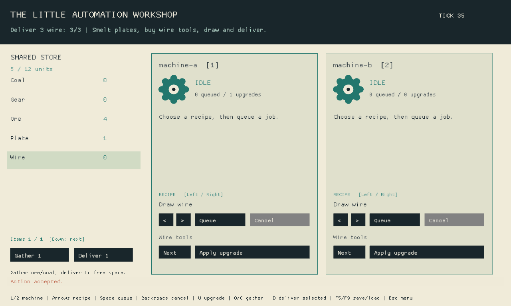

# Recorded milestone evidence

[results.json](results.json) records the implementation revision, regressions,
claims and unavailable gates. The final review tip and its hosted Linux/Windows
checks are on [PR 28](https://github.com/kevstermcgee/BlueEngine/pull/28).
`runtime-source.json` pins workload source/content bytes; benchmark and test reports
name their own binary/source identities. Evidence commits do not retroactively
change those measurement identities.

## Release comparison

Intel N97, four logical CPUs, 16 GB RAM, Debian Linux, Rust/Cargo 1.98.1;
release opt-level 3, thin LTO, four codegen units. Identical harness at pristine
`1441a433` plus the benchmark file, and the milestone implementation. Each workload
has 2,000 warmup ticks, 50,000 samples and twenty snapshot round trips. All three
final state hashes match. Full distributions, allocated requested bytes, save/load
latency and RSS series are in `release-before.json` and `release-after.json`.

| Workload | Before median / p99 µs | After median / p99 µs | Tick allocations over 50,000 samples | Save bytes |
| --- | ---: | ---: | ---: | ---: |
| blocked (1000 machines) | 1320.821 / 2084.744 | 8.655 / 12.045 | 1,000,000,000 → 0 | 287,684 |
| active (2 machines) | 3.425 / 4.418 | 0.747 / 1.418 | 2,370,000 → 710,020 | 1,091 |
| mixed (1000 machines) | 217.851 / 304.965 | 11.481 / 16.572 | 110,589,297 → 738,588 | 80,745 |

The blocked workload's unchanged inventory now reuses a complete-count comparison;
it no longer retries one thousand identical failing transactions each tick.
Validation and atomic commit still share the same resource validator. Mixed
commands and active production remain measured, rather than extrapolated from an
idle scene. The harness measures input application and simulation; input-vector
construction and snapshot work are outside the tick-allocation window.

`release-sustained-million.json` adds one million measured ticks per workload
(three million total), 400 save/restore operations each. The blocked workload
retains zero tick allocations. Its snapshot is 287,684 bytes; the comparable
50,000-tick run has 12.902 ms median save and 7.145 ms median load. These are
in-memory engine snapshot encoding/integrity/validation/restore latencies, **not**
file write/fsync latency. The timing vector pages in about eight MB during the
million-sample run; snapshot allocator retention and prior workloads also affect
RSS. This is sustained bounded evidence, not a proof of no leaks.

This shared N97 host was concurrently compiling checks. Wall-time differences
include contention and allocation instrumentation; they are not an exclusive CPU
benchmark, universal speedup, release capacity guarantee or strong tail estimate.
The older 51-tick N97 probes remain historical. `environment.json` gives identities,
limitations and exact release reproduction commands. The initial benchmark setup
was repaired to batch queue/gather as the original fixture does; only the same
repaired harness is used for this before/after comparison.

## Gameplay and captures

`playtest-parallel.json` and `playtest-serial.json`: seeds 0–7, 10,000 ticks each,
128 MiB per isolated Linux process, concurrency two versus one. All runs pass;
per-seed final hashes match regardless of completion order. Observed elapsed times
are 5.033 s and 8.969 s, including process orchestration on this host. The workload
uses real public commands, accounting/duplicate-action oracles, a defined active
job stall check and continued equivalence after save/restore.

`playtest-fault.json` is an **expected failure**, not an unsuccessful game result
hidden from the report. It injects duplicated gathering through the same authority;
seed 7 fails at tick 28. The complete `duplicate-fault.trace.json` reproduces the
same failure/hash. `playtest-final-source.json` repeats all eight seeds after the
CLI read-bound repair: all pass in 6.392 s with the same per-seed hashes.
`replay-final-source.json` verifies the retained failure and rejection of an
oversized trace on that binary. After building the recorded source, run:

```sh
/PATH/TO/release/workshop replay-playtest docs/perf/reliability/duplicate-fault.trace.json
```

[PLAYTESTING.md](../../PLAYTESTING.md) supplies build, budgets and replay instructions.
The normal harness retains complete traces in its output directory. Trace reduction
is deferred; the retained failure is only 28 turns and is already a single replay.



`goal.png` is native frame 40: the real game shows three wire delivered at restored
authority tick 35. `saved-wire.png` is frame 27 before delivery; the exact native
save is `captured-progress.be2save`. `results.json` records the full public-input
script, which saves at frame 25, delivers, restores at frame 31 and delivers again.
`workshop.png` separately shows blocked-output/cancellation recovery followed by
an upgrade and gear production. Captures are real Linux/Xvfb software rendering;
frame numbers are not wall-clock performance measurements.

`native.stdout.log`, `native.stderr.log` and `native-subsystems.json` retain the
actual capture result. Muted intent did **not** stop Macroquad's eager ALSA worker
from panicking. The public backend provides no device-health signal. Rendering
succeeded, audio health is unverified, and no audible-output success is claimed.
Physical keyboard/mouse/controller, subjective feel/enjoyment and Windows manual
install/upgrade/uninstall were unavailable. X11/XTest supplies actual OS event
integration evidence, separately from physical device review. Hosted native Windows
package/smoke and Inno installer builds are separate automated gates.

## Authoring and repairs

A fresh agent used ordinary `start`, selected public contracts and public workshop
edit/actions in a scratch copy. It authored a paid recycling upgrade and recipe
without reading engine implementation. The focused public-action test passed;
`authoring-additions.json` and `authoring-acceptance.rs` retain its additions and
acceptance. Copy them into an editable scratch Workshop to repeat the test.
`authoring-trial.json` records commands and failures, including `--help` returning
exit 1; the root implementation repaired help afterward. Scratch dependency/pin
paths needed preparation. Those are recorded costs, not omitted attempts.

The timed focused build/test took 4.576 seconds using warm shared artifacts. The
observed 107.543-second window begins **after** the initial intake/docs reads, so
it is not total elapsed effort. Total elapsed time, model-active time, separate
waiting/infrastructure time and uncached/cached/output tokens were unavailable.
No token estimate, dollar cost, cold-build comparison or universal authoring
speedup is inferred. The initial intake exposed over-budget guide text; the final
ordinary intake now passes the unchanged reading-budget tests.

`tooling.json` records all 21 maintained editable consumers, script reduction,
new-project inheritance and equivalent eight-Python/zero-Cargo pin-only plans.
The original Reverie/Afterpull mismatch was reproduced as six versus 54 commands
(49 Cargo) before replacing historical ownership with maintained declarations.
The final shared menu regression also prevents raw mouse edges from bypassing
focus/neutral/transition suppression. Fresh standalone generation, reserved metadata preservation, first-format checks
for every starter, exact bootstrap drift and stale explicit checker overrides are
covered through their actual public paths. Content and build boundaries retain
broader checks; immutable published exports were preserved.

Feedback fixtures validate the skip-marker/GITHUB_TOKEN/no-push-CI case, latest
matching successful/pending/missing/failed/cancelled verification, no acknowledgment
of changed code, decision reuse, fsynced receipts and unchanged-worktree cleanup.
No public feedback was fabricated. No real public player-driven improvement loop
is claimed. Remaining upstream audio limitations and subsequent netplay, updater,
world-region and optional narrative milestones are listed in `results.json` and
[PERSISTENT_RELIABILITY.md](../../PERSISTENT_RELIABILITY.md).

## Completed verification receipt

`verification.json` records the complete local 54-command pass at `63afc20`
(1,511.766 s), all 55 canonical performance rows in `docs/perf/metrics.jsonl`,
and the exact unchanged SDK/Workshop Git objects. Earlier failed full attempts
consumed 926.041, 537.182 and 1,957.876 seconds; their reports are retained.
These are actual check wall times, including overlapping Python/Cargo work,
not total authoring or model-active time.

The final native Workshop build repeats the three-wire save/load capture and
produces the exact retained goal image. Its binary identity and subsystem status
are recorded. Afterpull's headless/native suites each pass fifteen tests; native
format and all-target Clippy pass. Its actual shared-client verification completes
1,300 ticks, including public loss/undo/retry/clear actions, and wins all six rooms.
`afterpull.png` is a genuine capture. Its only subsequent cleanup removes the unused
import of its former key reader; the SDK and Workshop sources remain identical.
The retained duplicate-action trace also passes its same 28 turns with the fault
injection disabled. These checks establish behavior, separate from physical devices.

The checked `63afc20` checkpoint passed the full hosted Linux/Windows Engine
workflow, native/headless release builds, all game/package jobs and Sandbox.
The receipt's hosted status is timestamped by its checked revision. Completed final
platform gates update that status on [PR 28](https://github.com/kevstermcgee/BlueEngine/pull/28).
Physical input, audible hardware and manual Windows install/upgrade/uninstall
remain unavailable; no enjoyment certification is made.
